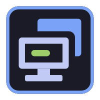
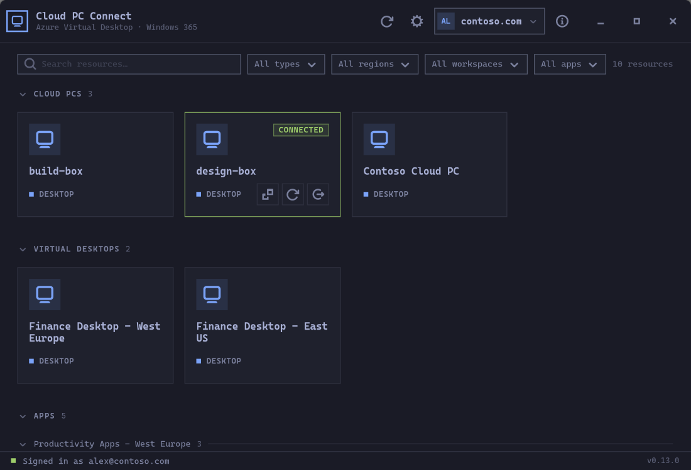
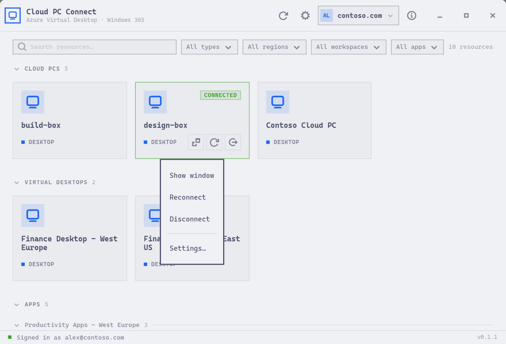
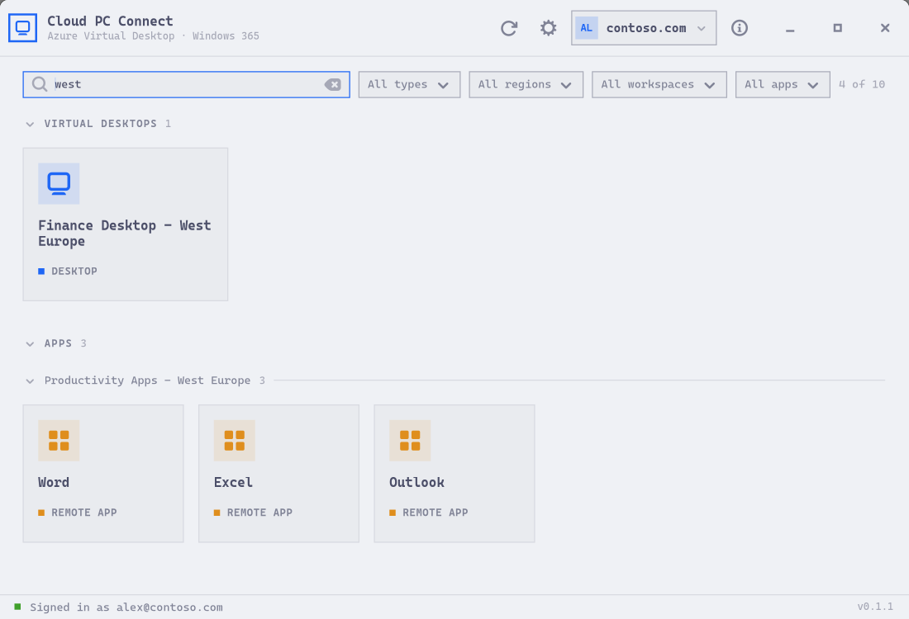
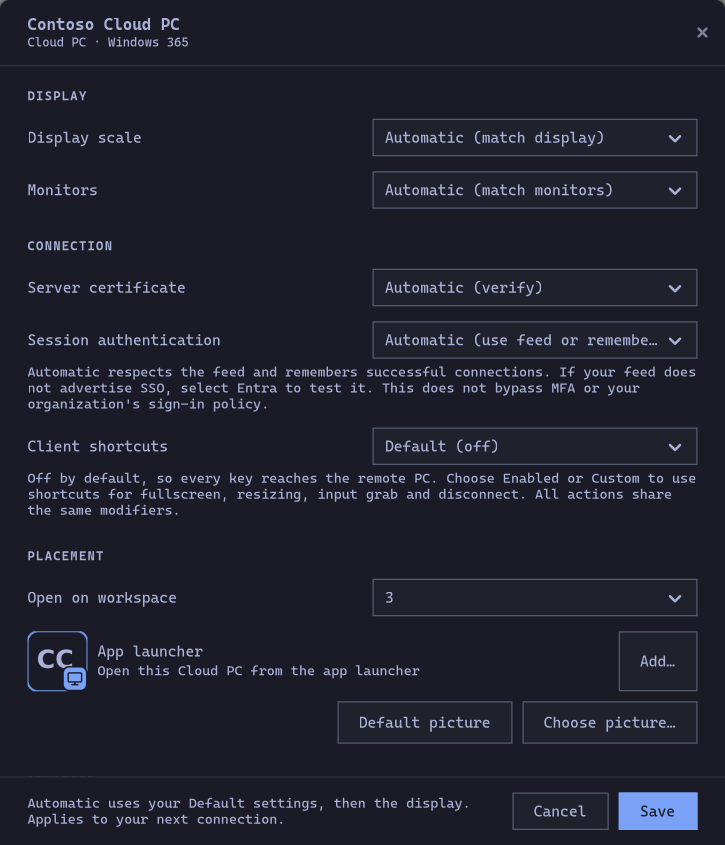

<p align="center">
  
</p>

<h1 align="center">Cloud PC Connect</h1>

<p align="center">
A Linux client for Windows 365 Cloud PCs, Microsoft Dev Box and Azure Virtual
Desktop, made for <a href="https://omarchy.org">Omarchy</a> and Hyprland.
</p>

Cloud PC Connect signs in to your work account, lists the Cloud PCs, desktops
and remote apps your organization gives you, and opens them with a bundled
FreeRDP client. It follows the Omarchy theme, places each Cloud PC on its own
Hyprland workspace and adds Cloud PCs to the Omarchy app launcher.

It is a fork of [AVD Feed + Connect](https://github.com/shakeelosmani/avd_feed_connect)
by Shakeel Osmani. Feed discovery, sign-in, the FreeRDP build and most
connection settings come from upstream. Changes that are not specific to
Omarchy belong upstream.

> Unofficial. Not affiliated with or endorsed by Microsoft or Omarchy.

## Screenshots

<p align="center">
  
  
  
  
  <br>
  <em>Example data in the Tokyo Night and Catppuccin Latte Omarchy themes.</em>
</p>

## Features

- Sign in with Microsoft Entra ID, including FIDO2 security keys such as a
  YubiKey, and keep several work accounts side by side.
- See your resources in three sections: Cloud PCs (Windows 365 and Dev Box),
  virtual desktops and apps. Search them and filter by type, region,
  workspace and app.
- Connect, reconnect, disconnect and bring a session window forward from the
  tile, its right-click menu or the tray icon.
- Open each Cloud PC on a fixed Hyprland workspace.
- Add a Cloud PC to the Omarchy app launcher with its feed icon or your own
  picture. The launcher icon carries a small PC badge.
- Use the security key inside the Cloud PC for Windows Hello and web sign-in
  (WebAuthn redirection).
- Redirect the microphone, camera, sound, clipboard and smart cards, and span
  several monitors.
- Run Teams call media on the local machine with the bundled Teams add-in
  (beta).

The window takes its colors, font and corner radius from the current Omarchy
theme and updates when you run `omarchy theme set`. On other desktops it uses
its own light and dark themes.

## Install

Cloud PC Connect is an Arch Linux package. It brings its own patched FreeRDP
and SDL in `/opt/cloud-pc-connect`, so it doesn't touch the system FreeRDP.

Install the package from the
[latest release](https://github.com/roddolf/CloudPcConnect/releases/latest):

```bash
sudo pacman -U https://github.com/roddolf/CloudPcConnect/releases/download/v0.1.0/cloud-pc-connect-0.1.0-1-x86_64.pkg.tar.zst
```

To update, install the package from a newer release the same way.

To build the package yourself, run `makepkg -si` in `packaging/arch` of a
checkout. The build compiles FreeRDP, SDL and the Teams add-in and downloads
a prebuilt libwebrtc, so it takes several minutes.

### Coming from AVD Feed + Connect

Cloud PC Connect installs next to upstream AVD Feed + Connect and keeps its
own data and keyring entries. To bring over accounts and resource settings
from the upstream Flatpak, copy its data directory before the first launch:

```bash
cp -r ~/.var/app/io.github.shakeelosmani.avd_feed_connect/data/avd-feed-connect \
  ~/.local/share/
```

You sign in once more, because sign-in tokens stay in the keyring of each
app.

## Getting started

1. Open Cloud PC Connect from the app launcher and sign in with your work
   account.
2. Double-click a resource, or select it and press Enter, to connect. The
   session opens full screen.
3. Right-click a tile for its actions. **Connect in a window** opens a
   resizable window instead of full screen.

The app signs the connection in with the account you are already using. A
sign-in window only appears when your organization requires MFA at connect
time. To sign in with a security key, choose the key in the Microsoft sign-in
page. The app then asks for the PIN and tells you when to touch the key.

## Finding resources

Click a section heading, or an app workspace heading under **Apps**, to
collapse or expand it. The app remembers this per account.

The search box matches names, workspaces, apps and regions. The filters next
to it list only the choices that still match the other filters, and a filter
only appears when the feed has more than one choice for it. Searching expands
collapsed sections until you clear the search.

The feed has no region field, so the app reads the region from resource and
workspace names such as "Productivity Apps - West Europe". The region filter
groups regions into areas, so Asia Pacific includes Southeast Asia.

## Tile actions

| State | Actions |
|---|---|
| Not connected | Connect, Connect in a window |
| Connecting | Cancel connection |
| Connected | Show window, Reconnect, Disconnect |

Every menu ends with **Settings…**. A connected tile also shows Show window,
Reconnect and Disconnect as buttons. Reconnect ends the session and starts it
again in the same window mode.

Open the menu with a right-click, the Menu key or Shift+F10.

## Keyboard shortcuts

| Key | Action |
|---|---|
| Arrow keys | Move between resources |
| Enter | Connect |
| Menu or Shift+F10 | Resource actions |
| `/` or Ctrl+F | Search |
| Escape | Clear the search |
| Ctrl+R or F5 | Refresh the feed |
| `?` | Show these shortcuts |

## Omarchy and Hyprland

### Workspaces

Open a Cloud PC's **Settings…** and set **Open on workspace**. The session
window moves to that workspace when it appears, and the app switches to it
after the session signs in. To stay on the current workspace, turn off
**Switch to a Cloud PC's workspace when it connects** in **Default
settings…** in the settings menu. The same dialog has **Open this window on
workspace** for the main window.

The app talks to the Hyprland IPC socket and does not edit your Hyprland
config. Each session gets a unique window title, so placement only moves that
session's windows.

### App launcher

Open a Cloud PC's **Settings…** and click **Add…** under **App launcher**.
After you confirm the desktop portal prompt, the entry shows up in the Omarchy
launcher (Super+Space). Choosing it starts the app if needed and connects.
**Choose picture…** sets your own image and **Default picture** goes back to
the feed icon. **Remove** deletes the entry.

Launcher entries need the DynamicLauncher interface of the XDG desktop portal,
which Omarchy has through `xdg-desktop-portal-gtk`. Without it the app hides
these controls.

### Passing shortcuts to Windows

Hyprland handles shortcuts such as Super+key before the session sees them.
To send them to Windows while a Cloud PC is full screen, add a submap to
`~/.config/hypr/bindings.lua` that keeps only the workspace keys:

```lua
hl.define_submap("cloudpc", function()
  for workspace = 1, 10 do
    hl.bind("SUPER + code:" .. tostring(workspace + 9),
      hl.dsp.focus({ workspace = tostring(workspace) }), { dont_inhibit = true })
  end
  hl.bind("SUPER + F", hl.dsp.window.fullscreen({ mode = "fullscreen" }), { dont_inhibit = true })
end)

local function update_cloudpc_submap()
  local window = hl.get_active_window()
  local cloudpc = window ~= nil and window.class == "com.freerdp.client.sdl3"
    and window.fullscreen == 2
  hl.dispatch(hl.dsp.submap(cloudpc and "cloudpc" or "reset"))
end

hl.on("window.active", update_cloudpc_submap)
hl.on("window.fullscreen", update_cloudpc_submap)
```

Omarchy's `shift:both_capslock_cancel` keyboard option can leave Shift held
in Windows. If that happens, set `kb_options` to an empty string in the same
function while a Cloud PC has focus.

### Tray

The tray icon lists every resource by account and workspace, with Connect,
Connect in a window, Show window, Reconnect and Disconnect. Left-click it to
show the main window. In the settings menu, **Keep running in the tray when
closed** hides the window instead of quitting, and **Start in the tray**
starts with only the tray icon. The Omarchy bar shows tray icons. Set
`AVD_TRAY=0` to turn the tray off.

## Settings

Each resource has its own **Settings…**. **Default settings…** in the settings
menu sets the values used by every resource left on Automatic. A resource
setting wins over the default, and the default wins over automatic detection.

| Setting | Automatic behavior |
|---|---|
| Display scale | Follows the display scale: 200% on HiDPI, 100% otherwise |
| Monitors | Spans all monitors when there is more than one |
| Server certificate | Pins the host certificate on first connect and refuses a changed one |
| Session authentication | Uses Entra sign-in when the feed supports it, otherwise username and password |
| Open RemoteApp as | Opens the app window |
| Open on workspace | Opens on the current workspace |
| Shared folder | Off. Home or a chosen folder appears in Windows as a `\\tsclient` drive |
| Advanced flags | None |

FreeRDP's own shortcuts (Right Shift with Enter, D, R, G or M) are always off,
so every key reaches Windows. Use Hyprland for full screen and the tile
actions to disconnect.

**Advanced flags** takes `sdl-freerdp` options separated by spaces. Quote a
value that contains a space, as in a shell.

| Flag | Effect |
|---|---|
| `/dynamic-resolution` | Opens a resizable window whose remote resolution follows the window, on one monitor |
| `/gfx` | Uses the GFX graphics pipeline with H.264 |
| `/network:auto` | Tunes codecs for the detected link |
| `-wallpaper -themes` | Drops the remote wallpaper and themes on slow links |
| `/d:AzureAD` | Sets the logon domain for host pools that need one |
| `/multimon`, `-multimon` | Forces multi-monitor on or off |

### Environment variables

Environment variables override the in-app settings. Set them in
`~/.config/uwsm/env` and log in again, or start the app with them:

```bash
AVD_SCALE=150 cloud-pc-connect
```

| Variable | Effect |
|---|---|
| `AVD_SCALE` | Remote scale in percent, such as `150` |
| `AVD_MULTIMON` | `1` or `0` forces multi-monitor on or off |
| `AVD_CERT` | `ignore` or `verify` for the server certificate |
| `AVD_REMOTEAPP` | `desktop` opens every RemoteApp as a full desktop |
| `AVD_EXTRA_ARGS` | Extra `sdl-freerdp` options, added after Advanced flags |
| `AVD_CLOUD` | `usgov`, `china` or `commercial` (the default) |
| `AVD_BROWSER_SIGNIN` | `1` or `0` forces sign-in in the system browser on or off |
| `AVD_SCHEME_SIGNIN` | `1` uses the app handoff instead of a loopback redirect on the commercial cloud |
| `AVD_TRAY` | `0` turns the tray icon off |
| `AVD_SDL_FREERDP` | Path to another `sdl-freerdp` binary |
| `AVD_SHARE` | `home`, `off` or a folder path for the shared folder |

## Backup and restore

Settings are plain JSON files:

```text
~/.local/share/avd-feed-connect/
├── settings.json                  app-wide settings and defaults
├── accounts.json                  saved accounts and display names
└── accounts/<account-id>/
    ├── settings.json              per-resource settings
    ├── launcher-icons/            pictures for launcher entries
    ├── auth-modes.json            remembered sign-in method per resource
    ├── workspaces.json, icons/, feed/   feed cache, rebuilt on refresh
    └── webview/                   Microsoft sign-in cookies
```

The app-wide `settings.json` has these keys:

| Key | Value |
|---|---|
| `_default` | Default settings for every resource |
| `_filters` | Last filter choices |
| `_collapsed_sections` | Collapsed sections per account |
| `_window_workspace` | Workspace for the main window, or `auto` |
| `_follow_workspace` | Switch to a Cloud PC's workspace on connect |
| `_theme`, `_language` | Appearance and language |
| `_browser_signin` | Sign in with the system browser |
| `_close_to_tray`, `_start_in_tray` | Tray behavior |

Each account's `settings.json` maps a resource ID to its settings, including
`teams`, `hypr_workspace`, `launcher_icon` and `launcher_id`.

The JSON files hold no secrets. Refresh tokens are in the login keyring.
To back up, copy the `avd-feed-connect` directory. Leave out `webview/` if
you don't want to carry the sign-in session. To restore, quit the app, copy
the directory back and sign in. Launcher entries belong to the desktop portal,
so add them again on a new machine.

## Sign-in

The app uses the same interactive Entra ID flow as the official clients, so
Conditional Access policies apply. It renews the access token in the
background and stores the refresh token in the login keyring.

**Asked to sign in every time.** A Conditional Access sign-in frequency policy
causes this, and no client can renew the token silently under it. The status
bar says so, and the app keeps your workspaces on screen. Because the
Microsoft session is remembered, signing in again is usually one click.

**Sign-in blocked on Linux.** Some tenants only allow Windows or Edge. In
**Default settings…**, set **Sign-in browser** to Microsoft Edge on Windows or
Google Chrome on Windows. The setting changes the identity of the sign-in
window only, for every account.

**Smart card, CAC or PIV.** The built-in sign-in window cannot present a
client certificate. Click **Sign in with a browser instead** on the sign-in
screen. The app opens the system browser and captures the result. The choice
stays on until you clear **Use the system browser to sign in** in **Default
settings…**.

**Sovereign clouds.** Set `AVD_CLOUD=usgov` for Azure Government or
`AVD_CLOUD=china` for Azure China. The feed, sign-in and connection then use
that cloud's endpoints. On these clouds the browser asks once to open
Cloud PC Connect, and the tab keeps spinning after the handoff. That is
expected.

**Feed blocked for Linux.** If your tenant refuses the feed but the AVD web
client lets you download an `.rdp` file, use **Open a downloaded .rdp…** in the
account menu. The file shows up under a Local .rdp files account. Its sign-in
opens in the system browser, and you paste the final address back into the
app.

**Username and password host pools.** When a host pool does not offer Entra
authentication, the app connects with NLA and FreeRDP asks for your password
each time. Hybrid-joined hosts accept your domain password. Hosts joined only
to Entra ID cannot use NLA from Linux. Ask your admin to turn on Microsoft
Entra ID authentication for the host pool.

## Teams calls

Teams chat and files work in any session. Without optimization, Teams runs
call media on the session host, which needs outbound UDP 3478 to 3481 to the
Teams relays.

Teams call optimization is on by default. Call audio and video run on the
local microphone, speakers and camera through the bundled
[freerdp-teams-redir](https://github.com/vchegwidden/freerdp-teams-redir)
add-in. After the first connection, restart Teams in the session once; calls
then show "AVD media optimized".

Change it under **Teams calls** in Default settings, or per resource in its own
settings: Audio and video, Audio only, or Off. Video opens in a separate
window and screen sharing is not supported. The add-in is unofficial, and a
crash in it ends the session, so pick Audio only or Off if calls drop the
connection.

## Troubleshooting

**A session stops taking keyboard and mouse input on NVIDIA.** NVIDIA's GL
driver can stall under XWayland while the window is on a hidden workspace. On
NVIDIA the app renders sessions with Vulkan and without vsync to avoid this.
Set `SDL_RENDER_DRIVER` yourself to choose another renderer.

**"Certificate changed" when connecting.** Pooled host pools can present a
different certificate on each host. Set **Server certificate** to Don't verify
for that resource.

**A RemoteApp never appears.** The bundled client has limited RemoteApp
support. Set **Open RemoteApp as** to Full desktop. This only works when the
host pool also grants you a desktop.

**Shortcuts don't reach Windows.** Hyprland handles them first. Add the
`cloudpc` submap from [Passing shortcuts to Windows](#passing-shortcuts-to-windows).

**Show window does nothing.** Hyprland needs `misc:focus_on_activate = true`.

## Development

Run a checkout with the installed package's FreeRDP:

```bash
export AVD_SDL_FREERDP=/opt/cloud-pc-connect/bin/sdl-freerdp AVD_SDL_LIBS=
python3 src/avd_feed_gui.py           # GUI
python3 src/avdfeed.py list           # CLI: list resources
python3 src/avdfeed.py connect 0      # CLI: connect to resource 0
python -m pytest tests
```

Without the package, build `sdl-freerdp` against SDL 3.2. Newer SDL releases
report a 0×0 display and full screen fails. The app adds `~/opt/sdl3/lib`, or
`AVD_SDL_LIBS`, to the client's library path.

`AVD_DEMO=1` shows the Contoso example data used for the screenshots.

FreeRDP and SDL patches live in `patches/`, and `packaging/arch/PKGBUILD`
lists why each one is there.

### Translations

The app speaks English and Spanish for Latin America, Spain and Argentina.
Choose a language in the settings menu, or keep the system language. The
catalogs in `src/avd_feed_connect/locales/` use the English string as the key.
`es.json` serves all three Spanish variants and regional files only override
wording. Run `python -m pytest tests/test_i18n.py` after editing them.

## License

MIT, the same as upstream. Bundled components keep their own licenses:
FreeRDP is Apache-2.0 and SDL is Zlib.
